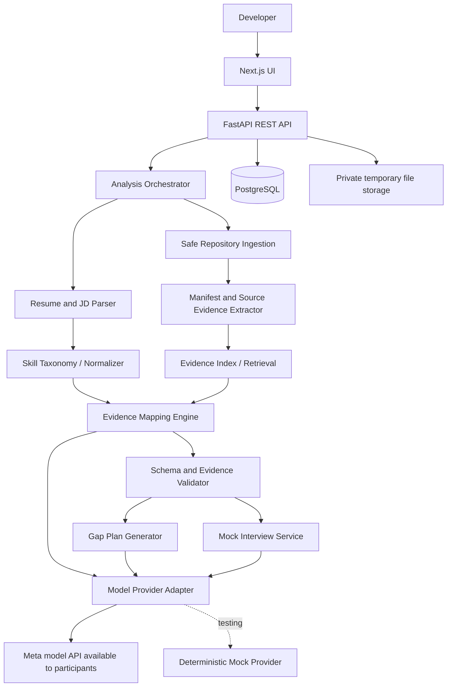
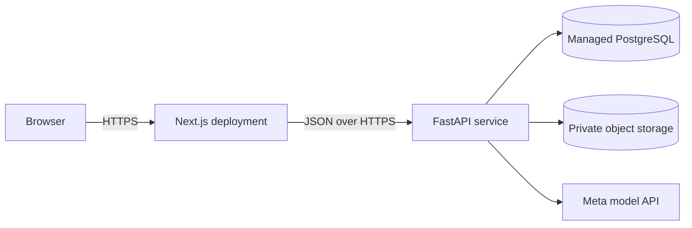

# ProofPath AI — System Design Blueprint

**Product:** Evidence-backed job copilot for software developers  
**MVP promise:** Given a resume, a job description, and a public GitHub repository or ZIP, generate a traceable skills report, preparation plan, and role-specific mock interview.

## Product principle
Never mark a skill as demonstrated unless the system can point to supporting evidence. “Not demonstrated” means insufficient evidence in supplied materials, not that the candidate lacks the skill.

## Documents
- `docs/PRODUCT_SPEC.md` — users, workflow, acceptance criteria
- `docs/FEATURES.md` — prioritized feature catalogue
- `docs/ARCHITECTURE.md` — components and data flow
- `docs/API_CONTRACT.md` — endpoints and payload examples
- `docs/DATA_MODEL.md` — entities and relationships
- `docs/SECURITY.md` — upload, repository and AI safety
- `docs/ROADMAP.md` — implementation plan
- `docs/DEMO_PLAN.md` — demo script and evaluation

## Recommended stack
- Frontend: Next.js, React, TypeScript
- Backend: Python, FastAPI, Pydantic
- Database: PostgreSQL
- Model: Meta model API available to hackathon participants, behind a provider adapter
- Local development: Docker Compose
- Retrieval: start with lexical retrieval; add embeddings/vector search only if evaluation justifies it

## MVP guardrails
- Support public GitHub repositories and local ZIP uploads first; defer private GitHub OAuth.
- Never execute code from submitted repositories.
- Validate every model-cited evidence ID on the server.
- Do not create an opaque employability score or invent experience.
- Keep a deterministic mock model provider for tests and demo fallback.

## Suggested repository layout
```text
proofpath-ai/
├── apps/web/             # Next.js + TypeScript
├── services/api/         # FastAPI
├── packages/contracts/   # shared API schemas (later)
├── docs/                 # design documents
├── infra/                # Docker Compose and deployment config
├── tests/fixtures/        # synthetic resumes, JDs and safe repositories
├── tests/e2e/
├── .env.example
├── docker-compose.yml
└── README.md
```


---

# Product Specification

## Problem and target user
Software developers applying for a role need to know which job requirements they can substantiate with their resume and projects, and what they should prepare next. Generic AI tools can repeat claims without showing evidence.

## Primary user story
“As a developer, I want to compare a job description with my resume and project repository, see evidence for each skill match, and get a practical preparation plan without exaggerating my experience.”

## Inputs
- Resume: text-based PDF or DOCX, with file size/page limits.
- Job description: pasted text for the reliable MVP path.
- Project source: public GitHub URL or ZIP upload.
- Optional: interview date, daily preparation time, target focus.

## Outputs
1. Job brief: role, seniority cues, required/optional skills, responsibilities.
2. Evidence matrix: requirement, status, rationale, source excerpt, file/path and line range.
3. Gap plan: prioritized practice tasks, estimated effort and completion checks.
4. Mock interview: question, answer, rubric feedback and grounded evidence.
5. Later: Markdown/PDF export.

## User flow
1. Create analysis and paste job description.
2. Upload resume.
3. Add public repository URL or ZIP.
4. Review extracted requirements and correct them.
5. Run evidence analysis.
6. Inspect evidence matrix and source excerpts.
7. Generate preparation plan.
8. Complete a project-specific mock interview.
9. Save or delete the analysis.

## Status vocabulary
- `demonstrated`: direct, validated supporting evidence exists.
- `partial_evidence`: relevant evidence exists but is incomplete.
- `not_demonstrated`: insufficient evidence was found in supplied materials.
- `needs_review`: ambiguity or extraction uncertainty needs human review.

## Acceptance criteria
- One analysis can run end-to-end without manual developer intervention.
- Parsing failures are clearly reported.
- Unsafe/oversized archives are rejected.
- Every demonstrated/partial mapping has a validated evidence pointer.
- Invalid model JSON is retried once or shown as an actionable error.
- Users can delete an analysis and its uploaded files.
- Tests use synthetic or public sample data.


---

# Feature Catalogue and Priorities

**P0:** required for hackathon MVP. **P1:** valuable if time permits. **P2:** post-hackathon.

## Workspace and inputs
- P0: single-user analysis workspace, privacy notice, pasted job description.
- P0: PDF/DOCX resume upload and validation.
- P0: one public GitHub URL or ZIP upload.
- P1: save and compare multiple analyses.
- P2: accounts, teams and collaboration.

## Job description intelligence
- P0: extract role, seniority cues, required/optional skills and responsibilities.
- P0: normalize common aliases such as JS/JavaScript.
- P0: allow user to edit extracted requirements.
- P1: explain why requirements matter.
- P2: browser extension and job-board integrations.

## Resume and repository understanding
- P0: extract resume skills and experience claims.
- P0: parse README, package manifests and selected source files.
- P0: safe archive extraction and file allowlist.
- P0: bounded evidence records with path and line range.
- P1: language-aware AST analysis for Python and JS/TS.
- P2: private repositories via least-privilege OAuth.

## Evidence mapping
- P0: map each requirement to resume/project evidence.
- P0: four status values and clear uncertainty.
- P0: validate all evidence IDs on the server.
- P0: store model/provider and prompt version metadata.
- P1: evaluate mapping quality against hand-labelled examples.
- P2: team review and annotations.

## Preparation plan
- P0: prioritize gaps using job importance and evidence status.
- P0: 3–7 tasks with effort estimates and measurable success criteria.
- P1: completion tracking and re-analysis.
- P2: spaced repetition and course integrations.

## Mock interview
- P0: generate 5–8 questions from the job and validated evidence.
- P0: one question per turn.
- P0: rubric for correctness, specificity, trade-offs, evidence alignment and communication.
- P1: follow-up questions and timed mode.
- P2: voice and live coding.

## Reports and operations
- P0: summary, evidence matrix, gaps, preparation plan and limitations.
- P0: clickable evidence drawer and clear loading/error states.
- P0: deletion and temporary-file cleanup.
- P0: tests for parsing, schema validation and unsafe input.
- P1: Markdown/PDF export, rate limiting, basic metrics.
- P2: billing and enterprise controls.

## Explicitly out of scope
Automated job applications, mass job-board scraping, private repo access, code execution, training a foundation model, and ranking candidates for employers.


---

# System Architecture

## Architecture choice
Use a modular monolith: one Next.js web app and one FastAPI service with clear internal modules. This is simpler to ship than microservices while keeping boundaries clean.

## Component diagram


## Deployment view


## Responsibilities
**Web app:** intake wizard, progress, report, evidence drawer, prep plan and interview UI. No API keys in browser.

**API:** validate payloads, create analysis IDs, return status/results, enforce ownership, provide actionable errors.

**Orchestrator:** parse inputs; extract evidence; normalize requirements; retrieve relevant evidence; call model with structured output; validate IDs/statuses; save report; generate plan and interview.

**Repository analyzer:** allow public GitHub URL or ZIP; enforce file/size/time limits; ignore binaries, dependencies, build artifacts and secrets; never install dependencies or execute submitted code.

**Evidence engine:** only use supplied evidence records; every demonstrated status needs validated evidence. Store source path, line range and excerpt.

**Model adapter:** one internal interface, such as `generate_structured(task, schema, input, timeout)`. Add the exact Meta provider after confirming participant docs and access. Keep a mock provider for tests.

## Analysis state
`created → processing → completed`; on unrecoverable error, `processing → failed`; explicit retry may return to `processing`; deletion blocks access immediately and then cleans stored artifacts.

## Reliability
Bound file count, total characters, model context and runtime. Use timeouts and one bounded retry. Start synchronously if it fits request timeouts; add a background worker only if measurements require it. Provide demo mode for provider/network failures.

## Key decisions
1. Modular monolith.
2. PostgreSQL as source of truth.
3. Files outside the database; references and hashes in DB.
4. Evidence records separate from generated explanations.
5. Model provider swappable.
6. No code execution on user-supplied repositories.


---

# API Contract (MVP)

Base path: `/api/v1`. Use FastAPI/Pydantic models and generate OpenAPI. IDs are opaque UUIDs.

## `GET /health`
```json
{"status":"ok","service":"proofpath-api","version":"0.1.0"}
```

## `POST /analyses`
Multipart fields: `job_description`, `resume_file`, and exactly one of `github_url` or `repository_zip`.

Response `202 Accepted`:
```json
{"analysis_id":"uuid","status":"processing","stage":"input_validation","poll_url":"/api/v1/analyses/uuid"}
```

## `GET /analyses/{analysis_id}`
Processing:
```json
{"analysis_id":"uuid","status":"processing","stage":"evidence_mapping","stage_message":"Comparing requirements with indexed project evidence"}
```

Completed response shape:
```json
{
  "analysis_id":"uuid",
  "status":"completed",
  "job_brief":{"role_title":"Full Stack Developer","requirements":[{"requirement_id":"req_1","name":"React","importance":"must_have"}]},
  "evidence_matrix":[{"requirement_id":"req_1","skill":"React","status":"demonstrated","rationale":"Found in resume and project source.","evidence_ids":["ev_14"],"confidence":"medium","limitations":[]}],
  "top_gaps":[],
  "preparation_plan":[],
  "limitations":["Analysis is limited to submitted materials."]
}
```

## Other endpoints
- `GET /analyses/{analysis_id}/evidence/{evidence_id}` — bounded excerpt and source metadata after ownership check.
- `POST /analyses/{analysis_id}/plan` — body: `{"daily_minutes":45,"days_available":7,"focus":"backend_interview"}`.
- `POST /analyses/{analysis_id}/interviews` — create session.
- `GET /interviews/{interview_id}` — current question/status.
- `POST /interviews/{interview_id}/answers` — body: `{"question_id":"q_1","answer_text":"..."}`.
- `DELETE /interviews/{interview_id}` — delete session.
- `DELETE /analyses/{analysis_id}` — block access and schedule deletion; return `204`.

## Error shape
```json
{"error":{"code":"UNSUPPORTED_FILE_TYPE","message":"Upload a text-based PDF or DOCX file.","trace_id":"opaque-id"}}
```

## API rules
Check ownership on every endpoint. Never return stack traces, provider keys or internal paths. Use 413 for size limits, 422 for validation, 404 for unavailable/not-owned resources, 429 for rate limits, 502/503 for provider failure. Server validates evidence references and status rules.


---

# Data Model

PostgreSQL stores structured records. Raw uploads live in private temporary/object storage; DB stores opaque key, checksum, content type, size and expiry.

## `analyses`
`id`, `owner_key`, `status`, `stage`, `stage_message`, `error_code`, `job_description_text`, timestamps, `pipeline_version`, `prompt_version`.

## `uploads`
`id`, `analysis_id`, `kind` (`resume`, `repository_zip`), `storage_key`, sanitized filename, content type, size, SHA-256, expiry and deletion timestamps.

## `requirements`
`id`, `analysis_id`, normalized skill, display name, type (`must_have`, `nice_to_have`, `responsibility`, `inferred_topic`), importance, source text, optional source offset, user-confirmed flag.

## `evidence_records`
`id`, `analysis_id`, source kind (`resume`, `repository`, `job_description`), source label, relative path, optional line range/page, bounded excerpt, content hash, extractor and version.

## `skill_mappings`
`id`, `analysis_id`, `requirement_id`, status, rationale, confidence, limitations JSON, created timestamp.

## `mapping_evidence`
Join table: `mapping_id`, `evidence_id`, composite primary key.

## `plan_steps`
`id`, `analysis_id`, position, title, reason, task, duration, success criteria JSON, status.

## `interview_sessions` / `interview_turns`
Sessions track analysis, status and rubric version. Turns track question, answer, feedback JSON, evidence IDs and position.

## `model_runs`
Store analysis, stage, provider/model ID, prompt version, status, duration, token counts, error code and timestamp. Do not store full prompts or resume text in routine logs.

## Constraints and retention
Index analyses by `(owner_key, created_at DESC)`, requirements by `(analysis_id, normalized_skill)`, and use foreign keys with predictable deletion. Add explicit retention defaults, upload TTL and deletion cleanup before public launch.


---

# Security, Privacy and Responsible AI

## Threat model
Resumes, job descriptions, ZIP archives, repository URLs, repository text and model output are untrusted. Repository text may contain prompt injection; treat it as data, never instructions.

## Upload controls
- Validate file signature and MIME, not extension alone.
- Bound bytes, pages, expanded archive size, file count, per-file size, decoded characters and processing time.
- Reject encrypted/unreadable files clearly.
- Reject ZIP path traversal, absolute paths, symlinks and unsafe nested archives.
- Exclude `.env*`, private keys, credentials, binaries, dependency folders, build outputs and generated files.
- Never execute source code, install dependencies, or run scripts from uploads.
- Store uploads outside web root; clean up on expiry and deletion.

## GitHub and SSRF controls
- Allow only expected HTTPS GitHub hosts and endpoints.
- Reject URL credentials, unexpected ports, IP-literal hosts and encoded-host tricks.
- Validate every redirect or disable redirects.
- Limit response size, download time, redirect count and repository file count.
- Do not fetch arbitrary links, submodules or external assets by default.

## AI and evidence integrity
- Separate trusted system instructions from untrusted document content.
- Request structured output with evidence IDs, not invented file paths.
- Validate schema, IDs, excerpt matching and output length server-side.
- A `demonstrated` mapping requires at least one validated evidence record.
- If support is weak, use `partial_evidence`, `not_demonstrated` or `needs_review`.
- Separate source facts from model inferences and recommendations.

## Privacy
- Explain which text is sent to the model provider.
- Send minimal relevant excerpts rather than entire repositories where practical.
- Keep provider keys server-side; never log resume text, tokens or interview answers.
- Provide deletion and clear retention for temporary uploads.
- Before public launch add authentication, ownership checks, rate limits, abuse controls and a privacy policy.

## Fairness
This is a career preparation tool, not an employer screening system. “Not demonstrated” is not proof the user lacks a skill. Avoid opaque employability scores and fabricated resume metrics.

## Tests
Cover path traversal, ZIP bombs, prompt injection, invented evidence IDs, malformed model output, oversized responses and unauthorized record access.


---

# Ten-Day Build Roadmap

Use this as an aggressive solo-developer plan. Verify hackathon cutoff and exact model access in participant materials.

## Phase 0 — Foundation
- Freeze scope: one JD + resume + public repository/ZIP → evidence report.
- Confirm Meta model API access, endpoint, supported model and limits.
- Create repository, frontend/backend skeleton, environment template and README.
- Add deterministic mock model provider.

**Exit:** frontend reaches FastAPI; `GET /health` works.

## Day 1 — Intake
Build UI and API contract; parse PDF/DOCX and pasted JD; persist analysis metadata.
**Exit:** user can submit resume/JD and preview parsed content.

## Day 2 — Repository ingestion
Support public GitHub and ZIP; implement limits, safe extraction, secret filters and evidence records.
**Exit:** safe sample repository indexed with stable paths/line ranges.

## Day 3 — Requirements
Extract and normalize skills; allow user confirmation/editing.
**Exit:** requirements are stable and schema-valid.

## Day 4 — Evidence mapping
Retrieve evidence; add model provider adapter; validate structured output, evidence IDs and status rules.
**Exit:** report has traceable evidence and no invented evidence IDs.

## Day 5 — Report and plan
Build overview, matrix, evidence drawer, top gaps and time-boxed plan.
**Exit:** intake → evidence report → plan works end-to-end.

## Day 6 — Mock interview
Generate 5–8 grounded questions; collect answers; evaluate with rubric.
**Exit:** complete interview demo.

## Day 7 — Reliability
Add e2e tests, deletion, timeouts, retries, clear errors and demo mode.
**Exit:** sample demo works even if provider is offline.

## Day 8 — Polish and evaluation
Responsive UI; test a hand-labelled set; measure citation validity, false demonstrated claims, parsing success and latency.
**Exit:** core quality checks pass.

## Day 9 — Deploy and rehearse
Deploy, check secrets/storage, record backup video, document setup and demo.
**Exit:** fresh-browser demo works.

## Day 10 — Submission buffer
Fix only high-impact issues; verify submission requirements, model attribution and deadline; submit early.

## Definition of done
- End-to-end demo with public sample repo.
- Every demonstrated skill links to valid evidence.
- At least 15 tests cover parsing, security, schema and status rules.
- Provider failure is handled with a clear message/demo fallback.
- Setup, configuration, limitations, retention and demo steps are documented.


---

# Demo Plan and Evaluation

## Story
A developer is applying for a Full Stack Engineer role. Their resume mentions React, Node.js and databases, but they want to know which requirements their project actually demonstrates and what to prepare next.

## Three-minute demo
1. 0:00–0:20 — Explain why generic AI career tools can make unsupported claims.
2. 0:20–0:45 — Submit synthetic resume, job description and sample repo.
3. 0:45–1:20 — Open a skill mapping and show real file/line evidence.
4. 1:20–1:45 — Show “not demonstrated in supplied materials” and explain the distinction.
5. 1:45–2:15 — Show a prioritized plan with effort and completion checks.
6. 2:15–2:45 — Answer one project-specific interview question and show grounded feedback.
7. 2:45–3:00 — Highlight traceability, safe repo analysis and no unsupported claims.

## Metrics
- Evidence citation validity: target 100%.
- Unsupported `demonstrated` mappings: target 0 in test set.
- Requirement extraction precision/recall on manually labelled examples.
- Parsing success on supported fixtures.
- Reviewer rating of plan actionability.
- Analysis latency and model cost.

## Test fixtures
Create synthetic MERN, Python/FastAPI and React job descriptions, resumes and safe sample repos. Include a negative control where a technology appears only in a dependency manifest, so the app does not overstate hands-on experience.

## Failure plan
- Model outage: use clearly labelled deterministic demo mode.
- GitHub outage: use local ZIP fixture.
- Resume parse failure: show actionable error and optionally allow pasted text.
- Invalid evidence pointer: block the mapping from `demonstrated`.
