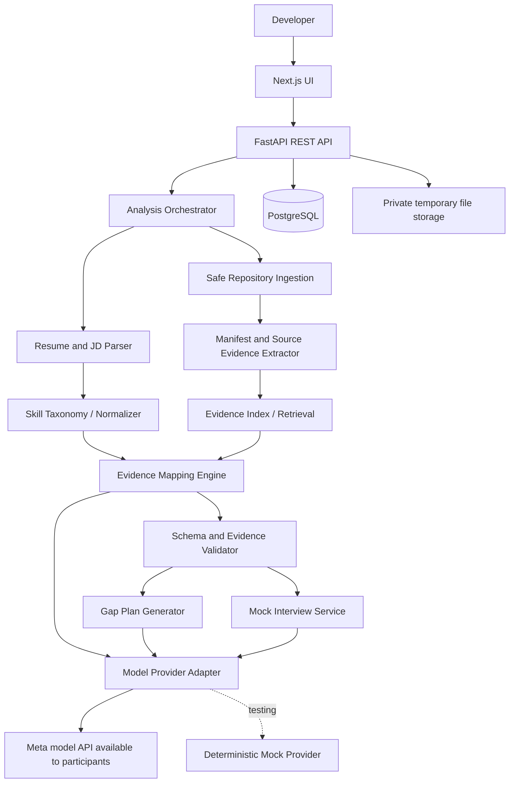
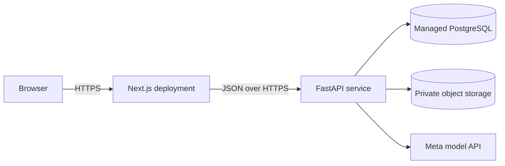

# System Architecture

## Architecture choice
Use a modular monolith: one Next.js web app and one FastAPI service with clear internal modules. This is simpler to ship than microservices while keeping boundaries clean.

## Component diagram

## Deployment view

## Responsibilities
**Web app:** intake wizard, progress, report, evidence drawer, prep plan and interview UI. No API keys in browser.

**API:** validate payloads, create analysis IDs, return status/results, enforce ownership, provide actionable errors.

**Orchestrator:** parse inputs; extract evidence; normalize requirements; retrieve relevant evidence; call model with structured output; validate IDs/statuses; save report; generate plan and interview.

**Repository analyzer:** allow public GitHub URL or ZIP; enforce file/size/time limits; ignore binaries, dependencies, build artifacts and secrets; never install dependencies or execute submitted code.

**Evidence engine:** only use supplied evidence records; every demonstrated status needs validated evidence. Store source path, line range and excerpt.

**Model adapter:** one internal interface, such as `generate_structured(task, schema, input, timeout)`. Add the exact Meta provider after confirming participant docs and access. Keep a mock provider for tests.

## Analysis state
`created → processing → completed`; on unrecoverable error, `processing → failed`; explicit retry may return to `processing`; deletion blocks access immediately and then cleans stored artifacts.

## Reliability
Bound file count, total characters, model context and runtime. Use timeouts and one bounded retry. Start synchronously if it fits request timeouts; add a background worker only if measurements require it. Provide demo mode for provider/network failures.

## Key decisions
1. Modular monolith.
2. PostgreSQL as source of truth.
3. Files outside the database; references and hashes in DB.
4. Evidence records separate from generated explanations.
5. Model provider swappable.
6. No code execution on user-supplied repositories.
